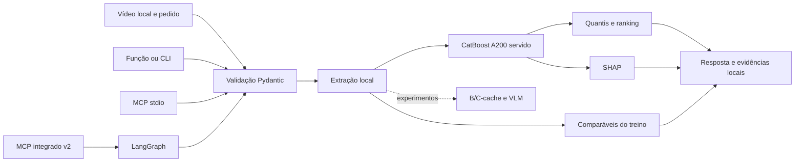

# iSee

O iSee é um projeto de análise preditiva de criativos de vídeo antes da publicação, desenvolvido por **Leunam Sousa** para a **Galaxies**, no contexto da **Inteli Academy**. O produto é uma aplicação local em Python: função, CLI e servidor MCP por stdio. Não oferece API web nem interface web. A persona da empresa pode consumir ferramentas MCP; a persona e a integração com a plataforma interna não fazem parte deste repositório.

[Currículo de Leunam Sousa](https://is.gd/sBFvr1) (Google Drive, somente leitura).

## Começar

Requer Python 3.11, `uv` e dependências de sistema para mídia. Na raiz:

```bash
uv sync --frozen
uv sync --project orchestration --frozen
uv run --frozen python -m scripts.demo_creatives
uv run --frozen python -m scripts.demo_creatives --synthetic-baseline
```

A primeira instalação pode usar a rede; com dependências em cache, use `--offline`. A demo cria entradas sintéticas e exercita a função e o transporte MCP. O segundo comando usa uma referência inventada. Nenhum deles representa uma previsão treinada. Os locks definem dependências e os ambientes ficam separados (`.venv/` e `orchestration/.venv/`).

Com os ambientes preparados, estes comandos consultam resultados públicos salvos ou agregados e mostram uma campanha fictícia:

```bash
.venv/bin/python -B -m scripts.apresentacao resultado
.venv/bin/python -B -m scripts.apresentacao metricas
.venv/bin/python -B -m scripts.apresentacao campanha
```

`resultado` lê uma projeção pública de três previsões preservadas; `metricas` lê métricas agregadas de validação; `campanha` combina um briefing inventado e números salvos sem associá-los a mídias. Nenhum comando repete extração, treino ou inferência.

## Manutenção

Com `make` e os dois ambientes já preparados, `make help` lista os comandos. `make check` roda lint, formatação e testes rápidos; `make test` executa as duas suítes completas em sequência. Os ambientes permanecem separados, e `make demo-mcp`, `make resultado`, `make metricas` e `make campanha` executam demonstrações ou exibem resultados preservados. Os comandos podem ser consultados sem execução com `make -n <alvo>`.

## Como funciona

O operador cadastra vídeos locais autorizados e envia de um a cinco IDs da mesma campanha e setor, setor (`moda` ou `beleza`), objetivo (`divulgacao`) e briefing. Um candidato recebe análise; vários recebem comparação. A previsão, quando disponível, inclui q50, faixa exploratória q10–q90 (cobertura não validada, sem garantia de 80%), versão do modelo e avisos. A ordenação usa q50. SHAP e comparáveis do treino podem compor as evidências.

O alvo é a contagem pública de visualizações observada com idade de 30 a menos de 37 dias. Não reconstrói o valor exato no dia 30. Curtidas não são entrada de um vídeo ainda não publicado e o briefing não muda a previsão numérica do M1.

A base reúne 300 YouTube Shorts de moda e beleza em português, coletados via YouTube Data API v3, de 166 canais: 203 referências de treino, 66 de validação e 31 reservadas para teste.



A CLI, a função e o MCP básico compartilham o analisador local; o MCP integrado v2 organiza um percurso separado com LangGraph. MCP usa stdio, não HTTP. A figura pontilhada representa trabalho experimental, sem aceite integrado.

## Estado e limites

- **A200** é o modelo servido. A previsão e a demonstração real dependem de recursos privados que não acompanham o clone.
- **A300, B-cache e C-cache** foram comparados na mesma validação de 66 vídeos e 37 canais. MAE médio de `log1p(views)` por canal: A200 **1,7349**, A300 **1,7761**, B-cache **1,6584**, C-cache **1,5444**. Menor é melhor. A validação participou da seleção; esses números não são do teste final.
- O teste reservado tem **31 casos** e permanece fechado. A comparação não demonstra desempenho prospectivo nem retorno comercial.
- V7 tem testes com gravadores e ensaios nativos B e C com dados inventados, incluindo persistência. B e C usaram fixtures e ambientes distintos; isso não é comparação científica pareada, treino observado ou bundle completo. A validação perceptiva dos sete campos VLM, a extração das 269 referências restantes e o treino B/C observado continuam pendentes.
- O contrato dos sete campos tem parser estrito e avaliação vinculada a 32 referências TRAIN, 16 por setor e de 24 canais reais. As referências têm duas anotações assistidas independentes e adjudicação, sem revisão humana. O suplemento anterior de 24 fontes TRAIN de beleza mantém `person_visible` com 24 verdadeiros e nenhum falso, e `product_closeup` com 21 verdadeiros, 1 falso e 2 desconhecidos após revisão da rubrica. Uma busca posterior parou ao verificar um negativo de pessoa: 48 fontes tentadas, 41 PNGs exatas, 7 falhas e 17 não tentadas. O negativo tem os sete campos selados em desafio separado, sem inferência do candidato; não comprova acerto do modelo nem estima acurácia populacional. Os conjuntos anteriores, a coorte de 300 e o split 203/66/31 permanecem intactos; mídias temporárias foram apagadas, e somente a identidade dos PNGs foi verificada. Veja o [contrato, os resultados e os limites](docs/guia-explicacao-isee.md).
- O candidato visual original mantém 13 resultados válidos preservados byte a byte e 19 casos sem resultado válido. O novo perfil privado com subconjuntos únicos de frames passou em um controle NIM sintético: HTTP 200 estritamente válido e sete valores esperados. Sua rodada real separada parou após 11 chamadas: oito respostas válidas, três HTTP 503 / `ResourceExhausted` e nenhum HTTP 200 inválido. Faltam 24 resultados válidos: um caso falhou e 23 não foram tentados. Os oito novos resultados ficam separados dos 13 antigos. Não há métrica do painel completo, aceite perceptivo, promoção ou release. A continuação com o mesmo candidato exige protocolo prospectivo e novo manifesto vinculado, reserva e orçamento, sem reabrir tentativas consumidas; não há reenvio automático. A validação dos sete campos, o suporte de classes e a revisão independente com release continuam necessários antes da extração das 269 ou do treino B/C observado.
- A seleção explicativa NIM também continua sem aceite. Duas tentativas sobre três análises reais cacheadas ficaram indisponíveis (HTTP 200 de causa desconhecida e, após correção do parser, HTTP 503). O briefing acadêmico mantém aderência parcial por metadados, sem validação comercial. Veja o [registro da execução](docs/fechamento-frente-2-resultados.md#tentativa-real-autorizada-de-2310).
- Clone público não inclui vídeos, coortes privadas, pesos de extratores nem bundles treinados. A evidência de origem e autorização da plataforma permanece limitada; consulte o relatório científico antes de interpretar os resultados.

A fachada `scripts.explanation_review_mcp_v1` oferece seleção dinâmica NVIDIA optativa com `--nim-provider nvidia --nim-reservation-dir <diretorio-novo-em-pasta-0700> --nim-authorized-zero-brl` e chave somente na variável `NVIDIA_API_KEY`. Esses flags habilitam `analyze_creatives_nim_reviewed`, com o mesmo payload de análise: uma execução do grafo, seguida de uma tentativa externa limitada a 45 s e reserva durável de uso único. O provedor recebe somente catálogo ordinal e valores reconhecidos; fonte, seleção efetivamente remota, complementos obrigatórios locais e revisão ficam separados. O teto global de 12 IDs pode deixar candidatos insuficientemente fundamentados. R$0 é declaração do operador, sem medição de faturamento; não há validação de campanha real nem liberação da configuração final. Sem esses flags, o comportamento anterior permanece.

## Guias

Veja o [índice de documentação](docs/README.md), o [guia de reprodução local](docs/guia-reproducao-local.md), o [guia de explicação](docs/guia-explicacao-isee.md) e o [relatório científico de fechamento](docs/relatorio-cientifico-fechamento-20261023.md). Protocolos preservados sustentam a reprodutibilidade. Para o estado operacional VLM atualizado em 24/10, consulte Estado e limites acima e o guia de explicação; o relatório científico de 23/10 preserva os resultados medidos até aquela data. O [histórico integral da documentação na revisão-base](https://github.com/leeunam/case-GALAXIES-IA/tree/0df616e5fd64dfc4947abde583f2664b66abf410/docs) mantém os registros de desenvolvimento retirados desta árvore.
